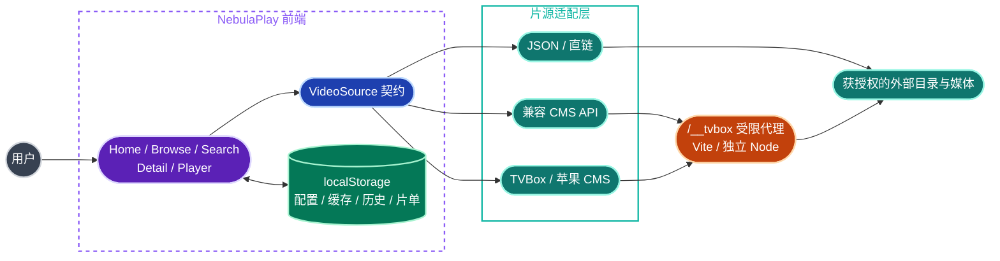

<div align="center">

# NebulaPlay · 星幕

**一个入口，聚合分散的片源**
**无广告 · 无账号 · 本地优先 —— 把干净的观影体验还给每个人**

[](#项目状态)
[](https://react.dev/)
[](https://www.typescriptlang.org/)
[](https://vite.dev/)
[](https://tailwindcss.com/)
[](./LICENSE)
[](https://nebu.life)

[在线站点](#在线站点) · [项目初衷](#项目初衷) · [功能一览](#功能一览) · [快速开始](#快速开始) · [片源接入](#片源接入) · [公益入口](#公益入口宝贝回家) · [参与贡献](#开发与贡献)

**非营利愿景 · 无账号依赖 · 本地保存 · 仅接入自有、获授权或公有领域内容**

</div>


## 项目初衷

> 想看一部剧，却要先记住它藏在哪个站点；想安静看片，却要先熬过广告、弹窗和诱导下载。
> NebulaPlay 想改变的，正是这件每个人都习以为常、却不该忍受的事。

| 过去的观影日常 | NebulaPlay 的做法 |
| --- | --- |
| 内容散落在不同站点，来回切换、逐个搜索 | 一个界面聚合多个片源，目录、搜索、选集、播放全部在一处完成 |
| 广告轰炸、弹窗、诱导点击 | 项目本身不接入任何广告、推广或跟踪内容 |
| 强制注册、会员墙、观看数据被收集 | 无账号系统；配置、历史、片单只保存在你自己的浏览器里 |
| 平台说没就没，收藏和进度一起消失 | Local-first：数据在本机，清除浏览器数据即可彻底删除 |

这条愿景同样有边界：NebulaPlay 是非营利项目，只接入使用者有权访问的内容，不提供、不转售、不担保任何第三方媒体。

## 目录

- [在线站点](#在线站点)
- [项目初衷](#项目初衷)
- [项目简介](#项目简介)
- [项目状态](#项目状态)
- [快速开始](#快速开始)
- [片源接入](#片源接入)
- [架构与数据流](#架构与数据流)
- [播放器](#播放器)
- [本地数据与隐私](#本地数据与隐私)
- [代理与部署边界](#代理与部署边界)
- [项目结构](#项目结构)
- [开发与贡献](#开发与贡献)
- [公益入口：宝贝回家](#公益入口宝贝回家)
- [开源协议](#开源协议)
- [免责声明](#免责声明)

## 在线站点

- 正式站点：[https://nebu.life](https://nebu.life)
- 源码仓库：[AliceDel66/NebulaPlay](https://github.com/AliceDel66/NebulaPlay)

线上实例用于展示当前开发版本，由维护者独立部署。它不要求注册账号，片源配置、搜索记录、片单与观看进度保存在访问者当前浏览器；第三方目录或媒体能否访问会受到授权、地区、跨域与上游可用性影响。

公开站点不改变本项目的使用边界：部署者和使用者仍须自行确认内容权利、第三方服务条款、隐私告知与所在地法律要求。

## 项目简介

NebulaPlay 把目录浏览、搜索、详情、选集和播放 UI 与数据来源解耦。UI 只依赖 `VideoSource` 契约；本地 JSON、直链、兼容 CMS API 和 TVBox/CMS 线路通过适配器接入同一套视图。

项目当前边界是：

- React/Vite 单页前端；
- Vite 开发服务器与独立 Node 进程共用的 `/__tvbox` 受限代理；
- 浏览器 `localStorage` 内的片源配置、缓存、搜索、片单和观看进度；
- 用户或维护者有权使用的外部目录与媒体服务。

当前目录中**没有业务后端、用户系统、云同步、内容授权系统或面向多用户的完整媒体网关**。独立 Node 进程只把现有受限代理带到自托管环境。

## 项目状态

### 功能一览

| | 能力 | 当前实现 |
| --- | --- | --- |
| 🧩 | 多片源装配 | 内置 CMS 线路、自定义 JSON/直链、兼容 CMS API、TVBox 多线路导入 |
| 💓 | 片源探活 | 优先资源组置顶、首次进入默认速播、延迟后台探测、失活缓存与自动轮换 |
| 🗂️ | 目录浏览 | 分类、类型/地区/年份/排序筛选、分页查询、最多 30 轮“全查询” |
| 🔍 | 搜索 | 当前目录本地排序 + 支持源的远程 `wd` 查询；搜索记录保存在本机 |
| ⏳ | 完整加载态 | 首页、分类、搜索、详情与播放器按各自请求边界等待，避免旧缓存或摘要数据提前渲染 |
| 📺 | 详情与选集 | 详情补全、多播放组解析、超长剧集每 100 集分页、当前播放页自动定位 |
| ▶️ | 播放 | MP4/WebM 原生播放、HLS.js、Safari 原生 HLS、多码率菜单、倍速、全屏、快捷键 |
| ⏭️ | 连续播放 | 同片切集保留播放器、只预取下一集、自动下一集、可配置跳过片头与片尾 |
| ⏯️ | 续播 | 按片源/影片/集数保存精确秒数；媒体 metadata 就绪后一次性恢复 |
| 📋 | 本地片单 | 首页入口可加入/移出片单；数据保存在浏览器 |
| 🛡️ | 受限代理 | SSRF 防护、Host/跨站限制、DNS/重定向复核、HLS URL 重写、Range/HEAD、超时与大小限制 |
| ✅ | 自动化验证 | Vitest 覆盖解码、CMS 映射、分页、探活、缓存、续播和代理安全边界 |

### 尚未完成或仅为占位

- 详情页“收藏”只在当前组件内切换，未持久化；“我的收藏”仍是空态。
- 详情页“片单”、分享，播放器评论、账号与通知尚未接入真实业务。
- 评论、评分分布和部分趋势展示含演示数据，不能作为真实用户评价或统计依据。
- 兼容 CMS API 的自定义 HTML 详情地址已有配置入口，但会受到开发代理活动 HTML 拦截，尚未形成可用的端到端路径。
- 页面导航使用组件状态，没有可分享的详情/播放 URL，也不支持刷新后恢复路由。
- `dist/` 仍是纯静态前端；自托管时必须同时部署 `dist-server/`，并由反向代理分流 `/__tvbox`。
- CI 目前只覆盖 typecheck / 测试 / 构建；没有正式发布流程、内容审核后台或权利投诉处理系统。
- `pnpm format` 尚未在全仓跑过：`oxfmt` 升级到 0.63 后风格与现有代码不一致，一次性格式化会产生跨 48 个文件的巨型 diff，需单独作为一次提交决策。因此 CI 不校验格式。

## 快速开始

### 环境要求

- Node.js `^20.19.0` 或 `>=22.12.0`（来自当前 Vite 8 引擎要求）
- pnpm
- 现代浏览器；Chrome/Edge 使用 MSE + HLS.js，Safari 可使用原生 HLS

### 启动开发环境

```bash
pnpm install --frozen-lockfile
pnpm dev
```

打开 <http://127.0.0.1:8443>。

首次进入时，应用会在首屏渲染后后台探测内置线路。外部端点可能失效、限流、跨域或返回非兼容格式；这类失败不等于前端构建失败。

### 验证代码

```bash
pnpm typecheck
pnpm test
pnpm build
```

这三条与 GitHub Actions（`.github/workflows/ci.yml`）在 push 与 Pull Request 上跑的完全一致。

常用命令：

| 命令 | 作用 |
| --- | --- |
| `pnpm dev` | 启动本地开发服务器，默认 `127.0.0.1:8443` |
| `pnpm typecheck` | 对前端与共享代码运行 `tsc --noEmit` |
| `pnpm test` | 单次运行 Vitest |
| `pnpm test:watch` | 监听模式运行测试 |
| `pnpm build` | 先 `typecheck`，再构建静态前端到 `dist/`，并编译代理进程到 `dist-server/` |
| `pnpm start:proxy` | 启动已编译的生产代理，默认仅监听 `127.0.0.1:8787` |
| `pnpm preview` | 预览 `dist/`；不注册开发代理 |
| `pnpm format` | 使用 oxfmt 格式化项目 |

## 片源接入

在顶部片源切换器中打开“自定义 / 手动配置片源”。

| 方式 | 输入 | 说明 |
| --- | --- | --- |
| JSON 片库 | JSON URL 或内联影片数组 | 远程 JSON 由浏览器直接请求，服务端必须允许 CORS |
| 媒体直链 | MP4、WebM、M3U8 等 URL | 可自动合成单片；必须由你拥有或获得播放授权 |
| 兼容 CMS API | 完整 CMS API，可选 HTML 详情站根地址 | CMS JSON 搜索/详情由浏览器兼容层处理；HTML 详情路径当前未闭环 |
| TVBox 多线路 | 含 `urls` 的订阅地址 | 导入后逐线路保存；只使用浏览器可处理的 CMS 站点 |
| 直接 CMS | 苹果 CMS JSON/XML API | 自动尝试 `videolist`、`vod_list`、`list` 与详情查询 |

TVBox 兼容范围有限：

- 支持 HTTP(S) 的 `type 0/1` 或未声明类型的 CMS 接口；
- 支持 JSON、常见 RSS/XML，以及含注释、尾逗号、BOM 的宽松 JSON；
- 支持 `vod_play_url` 多组线路与分集解析；
- 不执行 `type 3` spider、客户端私有协议、加密配置、脚本或 DRM 绕过逻辑。

内置资源列表会把维护者当前优先使用的五条线路置顶，首次进入默认选择“速播”；若后台探活确认该线路失效，应用仍会按既有机制自动轮换到其他可用线路。

> [!CAUTION]
> 不要把“能拉到目录”“能播放”当作授权证明。提交新片源时，应同时提供内容权利、接口使用许可与服务条款依据；无法核验的聚合端点不应作为默认配置合入。

## 架构与数据流



一条 TVBox/CMS 请求的实际路径：

1. `App.tsx` 合并内置线路与浏览器中保存的自定义配置。
2. `sourceHealth.ts` 延迟探活并过滤已确认失活的默认线路：结论有 6 小时 TTL，单轮最多探 16 条并按游标轮转，本轮没探到的线路沿用既有结论。
3. `useCatalog.ts` 等当前片源首屏数据完整返回；最多 7 天的目录缓存只在本次刷新失败时兜底。
4. `tvbox.ts` 解析配置或直连 CMS，选择可用站点并映射为 `Title`。
5. Browse/Search 把筛选、分页或关键词映射为 CMS 查询参数。
6. Detail/Player 拉取完整详情，解析播放组与分集地址。
7. M3U8 通过 `/__tvbox` 重写 manifest 内的分片、子清单和密钥 URL，再交给播放器。
8. 播放过程中按节流周期及暂停、隐藏、离开页面等生命周期保存进度。

## 播放器

播放器支持：

- Video.js 8 + VHS 与 Safari 原生 HLS；
- Master Playlist 多码率自动/手动切换；
- 切换播放线路或清晰度时保留当前时间与播放状态；
- 同一影片切集时保持 Player 页面，下一集线路就绪后原位替换，不返回整页 Loading；
- 默认开启自动下一集，并只预取当前集的下一集，不扫描整部剧；
- 可分别开启跳过片头、跳过片尾并设置 `0-600` 秒阈值；设置保存在当前浏览器；
- 播放/暂停、拖动进度、音量、静音、倍速、原生或网页全屏；
- 网络错误重新加载、媒体错误恢复及明确失败态；
- 仅当前页面可见、不会上传或持久化的本地弹幕。

键盘快捷键：

| 按键 | 行为 |
| --- | --- |
| `Space` / `K` | 播放或暂停 |
| `←` / `→` | 后退或前进 5 秒 |
| `J` / `L` | 后退或前进 10 秒 |
| `↑` / `↓` | 调整音量 |
| `M` | 静音 |
| `F` | 全屏 |
| `[` / `]` | 降低或提高倍速 |
| `0`–`9` | 跳到视频的对应百分比 |

续播规则：小于 5 秒、进度达到 95%，或距离片尾不超过 10 秒的记录不会触发续播；旧版只有百分比的历史记录仍可兼容。

## 本地数据与隐私

NebulaPlay 当前没有账号和服务端数据库。以下信息保存在当前浏览器的 `localStorage`：

| Key | 内容 |
| --- | --- |
| `nebulaplay:sources:v1` | 自定义片源配置 |
| `nebulaplay:history:v1` | 最多 24 条观看记录、集数与精确进度 |
| `nebulaplay:playlist:v1` | 本地片单 |
| `nebulaplay:searches:v1` | 最近 10 条搜索 |
| `nebulaplay:playback-preferences:v1` | 自动下一集、片头/片尾跳过开关与秒数 |
| `nebulaplay:catalog-cache:v1:<sourceId>` | 最多 300 条目录缓存，最长 7 天 |
| `nebulaplay:dead-sources:v1` / `live-sources:v1` | 内置线路探活结果 |
| `nebulaplay:source-health-run:v1` | 上一轮探活的时间与游标，用于 TTL 与分批轮转 |
| `nebulaplay:tvbox-site:v1` | 线路最近一次成功的 CMS 站点 |

清除浏览器站点数据会同时删除这些记录。隐私模式、存储被禁用或配额耗尽时，应用会降级运行，但配置与进度可能无法保存。

运行时仍可能向以下第三方发送网络请求：Google Fonts、图片地址、用户选择的目录 API 与媒体地址。部署者应自行提供隐私说明，并避免在片源 URL 中放置账号、Token、Cookie 或其他凭据。

## 代理与部署边界

`src/server/tvboxProxy.ts` 提供 `/__tvbox` 共用中间件：开发时由 Vite 注册，生产时由 `src/server/production.ts` 托管。它不是通用开放代理。默认限制包括：

- 服务默认仅监听 `127.0.0.1`；代理只接受本机或显式允许的 Host 与同站请求；
- 只允许 HTTP(S) 目标、`GET` / `HEAD` 和单段 byte Range；
- 拒绝 loopback、私网、链路本地、保留地址及重定向后的危险目标；
- 对 DNS 结果、重定向、并发、重试、总时限与文档大小做限制；
- 阻止活动 HTML、SVG、脚本内容，并为响应设置安全头；
- 客户端断开时中止上游流。

局域网调试需要同时开放监听并允许浏览器请求使用的 Host：

```bash
HOST=0.0.0.0 TVBOX_PROXY_ALLOWED_HOSTS=192.168.1.20 pnpm dev
```

`TVBOX_PROXY_ALLOWED_HOSTS` 是**进入代理的 HTTP Host 允许列表**，不是外部片源域名白名单。不要把 Vite 开发服务器或 Node 的 `8787` 端口直接暴露到公网。

并发预算分两档，避免目录/探活这类短请求把播放需要的槽位吃光（媒体分片会占住槽位直到整段传完）：

| 环境变量 | 默认 | 作用 |
| --- | --- | --- |
| `TVBOX_PROXY_MAX_CONCURRENT` | `64` | 代理在途请求总上限，播放与文档共用 |
| `TVBOX_PROXY_MAX_DOCUMENT_CONCURRENT` | `24` | 目录、详情、探活等**文档**请求的上限，恒不超过总上限 |

两者只接受正整数，填错时回落到默认值。超限返回 `429 TOO_MANY_REQUESTS` 并带 `retry-after: 1`。

仓库的 `deploy/` 提供 Nginx、systemd、UFW、Node 安装与版本化发布文件，面向单人自托管。公网入口只开放 Nginx 的 `80/443`，`/__tvbox` 反代到 loopback Node 服务。生产部署仍需按使用范围选择：

1. 单人自用：在现有 SSRF/并发限制外，再用 Basic Auth、VPN 或等价访问控制保护整个站点；
2. 多人或公开服务：实现固定上游、鉴权、配额、审计、内容治理与投诉处理的完整后端/边缘网关；
3. 纯静态托管：只接入允许浏览器 CORS 直连的自有或获授权服务。

单独托管 `dist/` 不会获得代理能力。仓库的 `.figma/make/site.json` 当前还设置了 `robots.index: false`，构建产物默认禁止搜索引擎索引；完成发布与合规审计前不应移除该限制。

## 项目结构

```text
.
├── src/
│   ├── main.tsx                 # React 入口与浏览器 API 兼容层安装
│   ├── App.tsx                  # 视图状态、片源装配、失败轮换
│   ├── data.ts                  # Title / VideoSource 契约与自定义 JSON 源
│   ├── tvbox.ts                 # TVBox/CMS 解析、查询、详情与播放地址
│   ├── cmsProfile.ts            # 苹果 CMS 数据模型与归一化
│   ├── decoder.ts               # 宽松 JSON / XML 解码
│   ├── SourceManager.tsx        # 自定义片源与 TVBox 导入 UI
│   ├── sourceHealth.ts          # 默认线路后台探活
│   ├── useCatalog.ts            # 目录加载、缓存与增量刷新
│   ├── history.ts               # 本地观看历史
│   ├── playbackProgress.ts      # 续播判定
│   ├── playlist.ts              # 本地片单
│   ├── ui.tsx                   # 播放器与通用 UI
│   ├── views/                   # Home / Browse / Search / Detail / Player
│   └── server/
│       ├── tvboxProxy.ts        # 开发/生产共用的受限代理
│       └── production.ts        # loopback 生产代理入口
├── deploy/                      # Nginx、systemd、UFW 与版本化发布脚本
├── vite.config.ts               # React、Tailwind、Figma Make 与代理插件
├── vitest.config.ts             # jsdom 测试配置
└── package.json                 # 依赖与脚本
```

## 开发与贡献

提交 Pull Request 前：

```bash
pnpm install --frozen-lockfile
pnpm typecheck
pnpm test
pnpm build
```

贡献约束：

- 保持 `VideoSource` 作为 UI 与数据来源之间的边界，避免让视图依赖某个具体 CMS。
- 新增解析规则时补充固定 fixture 测试，不让测试依赖实时第三方端点。
- 修改 `/__tvbox` 时优先保护 SSRF、DNS rebinding、重定向、内容类型和资源上限边界。
- 不提交 Token、Cookie、账号、付费接口、DRM 绕过逻辑或无法证明授权的媒体地址。
- 新增默认片源必须附上授权/许可、来源、适用地区和服务条款依据。
- UI 中的模拟数据必须明确标注，不得伪装成真实评论、评分、用户量或服务可用性。

适合优先贡献的方向：持久化收藏、移除演示评论/统计、URL 路由、无障碍、生产网关契约、CI 与第三方源合规清单。

## 公益入口：宝贝回家

站点 Footer 提供 [宝贝回家官方网站](https://baobeihuijia.com/) 公益入口，方便有寻亲需求或掌握线索的人抵达其官方平台。需要登记信息时，请直接使用其 [官方寻亲登记平台](https://reg.baobeihuijia.com/seek/homefind.html)。

- NebulaPlay 不隶属于、不代表宝贝回家志愿者协会，也不以其名义开展活动；
- NebulaPlay 不收集、保存、审核或转载寻亲者、失踪人员及线索提供者的个人信息；
- 请勿在本仓库 Issue、评论或片源配置中提交姓名、证件、联系方式、照片、住址等敏感信息；
- 公益入口仅为官方站点链接，不表示双方存在合作、赞助或背书关系。

## 开源协议

本仓库中由项目贡献者原创的源代码与文档采用 [MIT License](./LICENSE) 发布。

“非营利”描述的是 NebulaPlay 的项目愿景与维护方式，**不是对 MIT License 的额外限制**。MIT 允许复制、修改、分发、再许可和商业使用，但必须保留版权与许可声明。

MIT License **不覆盖**：

- 外部视频、音频、字幕、海报、字体、元数据与 API 返回内容；
- 第三方片源端点、订阅配置、服务名称与商标；
- 依赖包中由各自许可证管理的代码；
- 未经权利人授权提交到仓库的材料。

贡献代码即表示你有权提交该内容，并同意其按本项目 MIT License 分发。若你需要“禁止商业使用”，该限制不属于标准开源许可；请在发布前重新选择并由专业人士审阅许可证。

## 免责声明

> 本节提供项目边界说明，不构成法律意见，也不能替代部署者自己的版权、隐私、安全与服务条款审查。

1. **软件边界**：本项目只提供开源播放器 UI、片源适配器和受限网络代理代码，不生产、上传、存储、转码、销售、出租、授权或控制任何第三方视频、音频、字幕、海报与元数据。
2. **线上实例边界**：`nebu.life` 是维护者部署的项目实例，不是内容发行、授权或交易平台。站点可访问、页面可展示或媒体可播放，不构成任何权利、许可、来源可靠性或长期可用性的证明。
3. **使用者责任**：软件可能访问或临时转发使用者、部署者或维护者配置的第三方目录、图片与媒体。相关人员必须自行确认其拥有访问、展示、复制、传输及公开传播所需的权利，并遵守所在地法律和第三方服务条款。
4. **允许内容**：请仅接入自有、明确授权、适用 Creative Commons 条款允许或已进入公有领域的内容。不得利用本项目绕过付费、登录、地区、DRM、访问控制、反爬限制或其他技术保护措施。
5. **公开不等于授权**：片源可访问、接口成功返回、URL 可被搜索、内容未加密或第三方声称“免费”，均不代表内容可以合法使用。上游服务可能随时失效、限流、修改条款、替换内容或记录访问日志。
6. **第三方独立性**：README、代码、默认配置或站点中出现的第三方网站、接口、作品、名称与商标，仅用于说明兼容性或提供外部入口；除非另有书面声明，不表示隶属、合作、赞助、认可或背书。
7. **隐私与日志**：浏览器会在本地保存配置、搜索、片单和观看进度；部署环境、反向代理、CDN、DNS 及上游服务仍可能处理 IP、User-Agent、请求 URL 等技术数据。部署者应提供适用的隐私说明、设置合理保留期限，并避免在 URL、日志、Issue 或截图中暴露 Token、Cookie、个人资料和寻亲信息。
8. **无担保**：本项目与线上实例均按现状提供。维护者不保证软件或外部片源的准确性、完整性、合法性、持续可用性、安全性、适销性或特定用途适用性；源代码继续受 MIT License 的 “AS IS” 条款约束。
9. **责任限制**：在适用法律允许的最大范围内，因安装、部署、配置、访问或使用本项目及第三方服务产生的内容纠纷、账号风险、数据丢失、服务中断或其他损失，由相关使用者和部署者承担；本节不排除法律不得排除的责任。
10. **权利通知与处理**：权利人如认为仓库中的默认配置、链接或材料侵害其权益，可通过 [GitHub Issues](https://github.com/AliceDel66/NebulaPlay/issues) 提供目标文件/URL、权利归属说明、具体诉求和可安全公开的联系方式。维护者会在合理核验后移除、限制或更正争议内容。请勿在公开 Issue 提交身份证件、住址、未成年人信息或其他敏感材料。

安全漏洞请优先使用 GitHub Private Vulnerability Reporting；若仓库尚未启用该功能，再创建不包含密钥、个人数据或可直接利用细节的 Issue。版权与隐私事项可能因司法辖区而异，部署公开实例前应取得合格专业人士的独立意见。

---

<div align="center">

**如果这个项目也解决了你的困扰，欢迎 Star、贡献代码，或只是把它分享给同样被广告困扰的朋友。**

</div>

<details>
<summary>English summary</summary>

NebulaPlay is an alpha-stage, local-first web client for browsing and playing media from pluggable, authorized sources — built so viewers no longer have to hop between sites or sit through ads. It includes React/Vite UI, JSON/CMS/TVBox adapters, local history and resume, HLS playback, and a restricted proxy shared by development and self-hosted production runtimes.

Original project code and documentation are licensed under the MIT License. The license does not grant rights to third-party media, metadata, artwork, endpoints, services, or trademarks. Only use content you own, are authorized to use, or that is available under applicable public-domain/open licenses. Self-hosting requires both `dist/` and `dist-server/`; deploying `dist/` alone provides no proxy capability.

</details>
